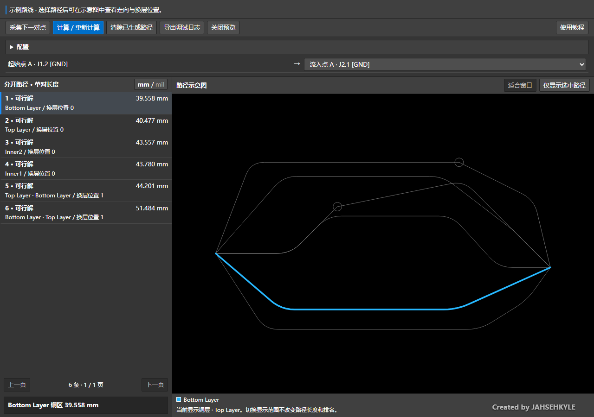
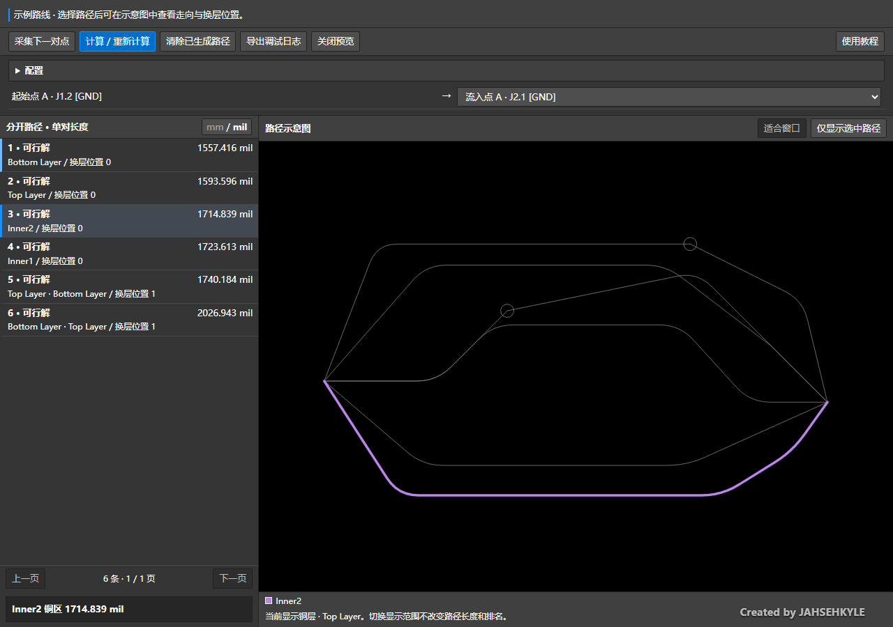
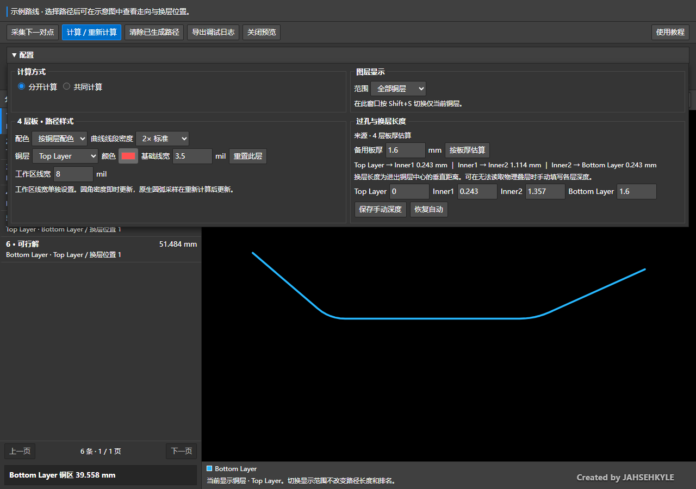
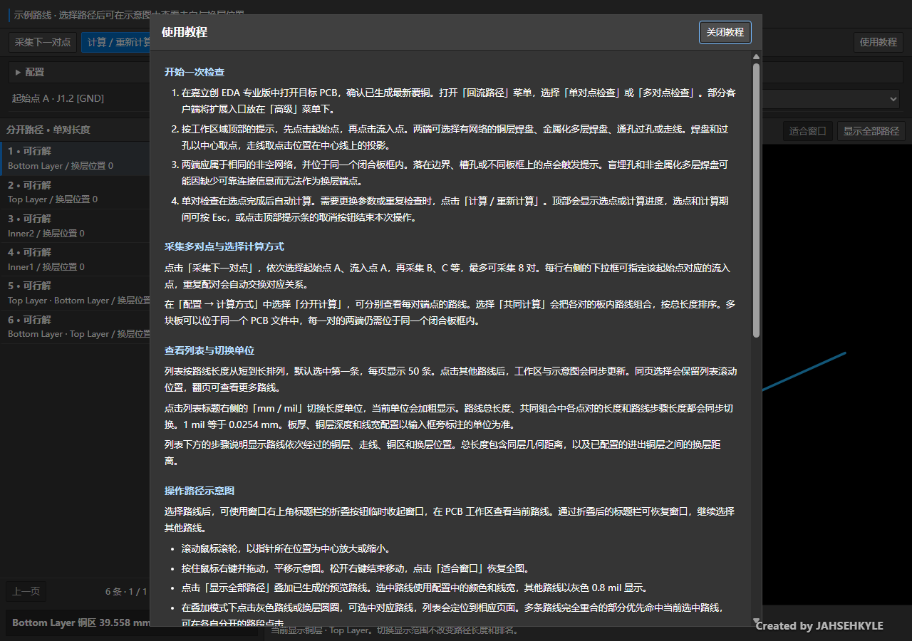

# 回流路径检查 · Return Path Inspector


嘉立创 EDA 专业版 PCB 扩展。选择起始点和流入点，查看同一网络铜箔中的不同可行路线、换层位置和几何长度。

**当前版本 v1.0.3 正式版** · Windows · 嘉立创 EDA 专业版 V4.1

**Apache-2.0 开源许可**：允许遵守协议的商业使用、修改和分发，分发时须保留许可证及相关版权声明。详见 [中文许可证说明](docs/licensing.md)。

[下载扩展](https://github.com/JAHSEHXKYLE/return-path-inspector/releases) · [版本记录](CHANGELOG.md) · [1.0 发布与验证记录](docs/release-1.0.md) · [详细判定范围](docs/guide.md#判定与范围)

本页为图文使用说明书。截图使用 v1.0.0 的实际界面与示例路线数据，在独立浏览器中渲染，展示结果窗口的内容区。

## 安装与第一次检查

1. 在 [Releases](https://github.com/JAHSEHXKYLE/return-path-inspector/releases) 下载 `return-path-inspector_v1.0.3.eext`。
2. 在嘉立创 EDA 中打开目标 PCB，通过 **高级 → 扩展管理器 → 导入** 选择扩展包，并在已安装列表中启用。扩展包内置项目 PNG Logo，已安装列表会使用该图标。
3. 确认 PCB 已生成最新覆铜。打开 **回流路径 → 单对点检查**，按顶部提示先点击起始点，再点击流入点。部分客户端将扩展入口放在「高级」菜单下。
4. 两点采集完成后自动计算，列表按长度排列不同的可行解。默认选中第一条，工作区同步显示这条路线。

两端可选择有网络的铜层焊盘、金属化多层焊盘、普通过孔或走线。起始点与流入点须属于相同的非空网络，并处于同一个闭合板框内。放大后点击焊盘中心，可减少铺铜或器件遮挡造成的误选。

### 从测试版升级

1. 在扩展管理器中导入 v1.0.3 包，按客户端提示更新同名扩展。
2. 检查已安装版本及项目图标，重新打开一次「回流路径」窗口。
3. 当前 PCB 的颜色、线宽、板厚和铜层深度沿用原配置。需要更新路线结果时，点击「计算 / 重新计算」。
4. 测试版登记的预览线可通过「清除已生成路径」清理。备份文件、工程权限及 PCB 的保存操作按项目原有流程处理。

Releases 同时提供安装包的 SHA-256 文件。Windows PowerShell 中可用 `Get-FileHash .\return-path-inspector_v1.0.3.eext -Algorithm SHA256` 核对下载内容。

## 查看路线

点击列表中的路线，可同步查看工作区和示意图。点击 **显示全部路径**，会把其他已生成的预览叠加为灰色细线，当前选中的路线按铜层配色高亮。列表下方显示路线经过的铜区、走线及换层步骤。



列表每页显示 50 条，使用「上一页」「下一页」浏览。点击同页中的其他路线会保留列表滚动位置。列表保留搜索得到的代表路线，画布叠加使用独立的预览容量，剩余路线可逐条选择查看。

### 单位切换与示意图操作

点击列表标题栏最右侧的 **mm / mil** 按钮，切换列表总长度及路线步骤的显示单位。当前单位加粗显示，1 mil = 0.0254 mm。



| 操作 | 效果 |
| --- | --- |
| 点击列表行 | 选中路线并更新工作区与示意图 |
| 点击「显示全部路径」 | 叠加其他可预览路线，灰线宽度为 0.8 mil |
| 点击示意图的灰线或换层圆圈 | 选择对应路线，列表自动定位到相应页面 |
| 鼠标滚轮 | 以指针位置为中心缩放 |
| 按住鼠标右键拖动 | 平移示意图 |
| 点击「适合窗口」 | 恢复全图 |
| 按 Shift+S | 在结果窗口中切换当前铜层显示 |

完全重合的路段优先命中已选路线，可在分开的路段点击其他路线。切换路线与叠加预览时，标题栏显示加载提示，重复查看会复用已计算的预览几何。

### 临时折叠窗口

使用结果窗口**原生标题栏右上角的折叠按钮**，临时收起窗口，在 PCB 工作区查看当前路线。通过折叠后的标题栏恢复窗口后，可继续选择路线。该按钮位于 EDA 的窗口边框，本页的内容区截图覆盖列表与示意图。

## 多对点与共同计算

1. 打开 **回流路径 → 多对点检查**，按提示采集起始点 A、流入点 A。
2. 点击 **采集下一对点**，继续采集 B、C 等，最多 8 对。
3. 每行右侧的下拉框可选择该起始点对应的流入点。出现重复对应关系时会交换流入点，保持一对一。
4. 在 **配置 → 计算方式** 选择模式，点击 **计算 / 重新计算**。

| 计算方式 | 查看方法 |
| --- | --- |
| 分开计算 | 在列表标题栏下方选择点对，逐对查看路线 |
| 共同计算 | 将各对的板内路线组合，按各对长度之和排序 |

多块板可以位于同一个 PCB 文件中，每一对的两端仍须在同一个闭合板框内。共同组合按需生成，列表通过翻页加载。

## 配置图层、颜色与换层长度

展开 **配置** 可查看计算方式、图层显示、路径样式和过孔与换层长度。



### 图层显示

- **跟随画布** 根据 EDA 中的图层显示状态过滤预览。
- **仅当前铜层** 显示当前层，也可在「指定铜层」中手动选择。
- **全部铜层** 展示路线经过的各个铜层。

主画布按 Shift+S 隐藏其他层时，跟随模式会相应过滤路径。

### 路径样式

| 设置 | 用法 |
| --- | --- |
| 配色 | 按铜层配色、逐层自定义或统一颜色 |
| 铜层、颜色、基础线宽 | 逐层设置示意图样式，默认基础线宽 3.5 mil |
| 工作区线宽 | 默认 8 mil，可在 0.2–50 mil 范围内设置 |
| 曲线线段密度 | 1× 至 4×，提高密度可增加圆角预览线段 |
| 重置此层 | 恢复选中铜层的默认样式 |

圆角密度会即时更新预览，原生圆弧采样在重新计算后更新。预览圆角受实际铜区边界约束。样式参数按 PCB 在本机保存。

### 过孔与换层长度

扩展优先读取物理叠层，按进入和离开铜层的中心深度差计算换层距离。无法读取完整叠层时，可使用以下配置。

- 填写 **备用板厚**，点击 **按板厚估算**，根据当前 PCB 的铜层数估算各层深度。
- 填写每个铜层相对顶层中心的深度，点击 **保存手动深度**。顶层为 0，各层深度须不同，底层最深。
- 修改后点击 **计算 / 重新计算**，让新的换层距离参与长度计算和排序。

备用板厚默认 1.6 mm。四层板采用参考叠层的间距比例，其他层数的估算规则及物理叠层接口范围见 [详细使用指南](docs/guide.md)。

## 取消、清除与日志

- **选点或计算期间** 按 Esc，或点击顶部提示条的取消按钮，可终止本次任务并释放求解缓存。已发出的 EDA 读取请求返回后会丢弃结果。
- **清除已生成路径** 删除扩展登记的预览图元。重新计算会先清理上次预览。
- **关闭预览** 关闭结果窗口。已写入「回流路径预览」非铜自定义层的图元可继续通过该层查看。
- **导出调试日志** 打开日志弹窗，点击「保存 .log 文件」，或选择文本后复制。日志包含网络、坐标、选点、建模、搜索阶段及预览操作，适合反馈问题时提供。
- **回流路径 → 查看运行日志** 打开 EDA 原生日志面板，查看带有 `[回流路径]` 前缀的条目。

关闭结果窗口或取消检查时，会清空会话日志。手动导出的日志文件可留作调试。

## 内置使用教程

点击工具栏最右侧的 **使用教程**，可在软件内查看详细说明。点击「关闭教程」或按 Esc 返回。教程打开时按 Esc 会关闭教程。



## 结果含义与计算范围

求解会尝试起点的其他出发方向、沿途岔口、从流入点反向搜索，以及两端共有铜层上的全程同层路线。一个焊盘与同一覆铜区的不同接触位置会分别接入求解图。反向结果统一回原顺序，相似走法保留较短的代表。符合几何条件的近邻过孔会合并，减少重复换层分支。

长度由可读取的铜箔几何和换层距离计算。搜索使用连接图、时间和状态预算，达到预算或铜箔读取受限时，界面会报告相应提示。复杂铜区的最短结果属于搜索得到的候选近似值，实际电流分布、回流阻抗和高频耦合需要电气模型。

保存 PCB 时，预览图元可随设计保存。归档或生成生产资料前，可通过扩展清除专用预览层中的路径。更多几何判定、保存范围和已知限制见 [详细使用指南](docs/guide.md#判定与范围)。

## 从源码构建

使用 **Node.js 22+** 和 **Python 3.10+**，构建和测试使用标准库。

```sh
git clone https://github.com/JAHSEHXKYLE/return-path-inspector.git
cd return-path-inspector
node --test test/popup.test.cjs test/return-path.test.cjs
python -m unittest discover -s test -p "test_*.py" -v
python build.py
python build.py --verify build/dist/return-path-inspector_v1.0.3.eext
```

构建结果位于 `build/dist/return-path-inspector_v1.0.3.eext`，同目录生成 `.eext.sha256`。相同源码和构建环境的重复构建会生成相同安装包。GitHub Actions 在 Windows 环境中测试和打包。推送与 `extension.json` 版本一致的 `v` 标签后，构建通过的扩展包及校验文件会发布到 Releases，发布说明使用对应版本的中文更新记录。

| 路径 | 内容 |
| --- | --- |
| `src/geometry.js` | 铜箔连接图、路线搜索与几何处理 |
| `src/pcb.js` | EDA 图元读取、板框与叠层适配 |
| `src/index.js` | 扩展入口、交互状态与工作区预览 |
| `iframe/` | 结果窗口、内置教程与选点提示 |
| `images/` | 扩展管理器 PNG 图标、扩展广场 JPEG 横幅与 SVG 原稿 |
| `test/` | 求解器、界面及 EDA 接口模拟测试 |
| `docs/images/` | 本说明书使用的操作截图 |
| `docs/guide.md` | 详细使用指南与判定范围 |
| `build.py` | 读取版本并构建扩展包 |

扩展安装包同时包含 LICENSE、NOTICE、README、CHANGELOG、详细指南及本页的操作截图，便于扩展广场展示和离线查阅。
